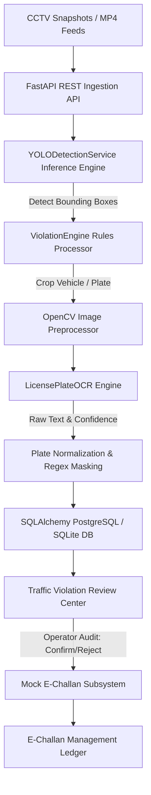

# TrafficEye AI 🚦📸
> **AI-Powered Traffic Violation Detection, License Plate Recognition & E-Challan Management System**

[](https://python.org)
[](https://fastapi.tiangolo.com)
[](https://pytorch.org)
[](https://ultralytics.com)
[](LICENSE)

TrafficEye AI is a production-grade full-stack engineering prototype designed for automated municipal traffic law enforcement, tailored for metropolitan traffic management authorities (e.g. **Bengaluru Traffic Police - BTP**). Integrating modern Computer Vision (YOLOv8 object detection), image preprocessing, and optical character recognition (OCR), the system processes roadside CCTV snapshots and video feeds to automatically detect infractions, recognize vehicle license plates, provide an operator verification portal, and manage digital citations (E-Challans).

---

## 📌 Problem Statement

Rapid urbanization and expanding vehicle volume in metropolitan centers (e.g. Bengaluru, Silk Board Junction, Marathahalli) have made manual traffic policing unsustainable. Major safety infractions—specifically **riding without a helmet, triple riding, wrong parking in restricted zones, and signal jumping**—contribute to over 60% of urban traffic casualties and severe gridlock.

**TrafficEye AI resolves this by:**
1. **Automating Detection**: Using edge computer vision (YOLO) to continuously scan traffic streams and flag candidate infractions.
2. **Standardizing Human Verification**: Providing an operator audit portal where human officers can confirm/reject candidate detections and verify OCR plate extraction.
3. **Automating Citation Lifecycle**: Generating official-format digital E-Challans linked to vehicle databases with Motor Vehicles Act fine schedules.

---

## ⚙️ System Architecture



---

## 🌟 Key Features

### 1. Real-Time Computer Vision Pipeline
- **Vehicle & Person Detection**: Detects motorcycles, cars, buses, trucks, pedestrians, and traffic lights using Ultralytics YOLOv8.
- **Rule-Based Violation Engine**:
  - **No Helmet Rider**: Detects two-wheelers and evaluates rider head region for protective helmet gear.
  - **Triple Riding**: Identifies motorcycles carrying 3 or more occupants.
  - **Wrong Parking Zone**: Evaluates stationary vehicle bounding boxes against configurable polygon ROI zones.
  - **Signal Violation Framework**: Flags vehicles crossing stop lines while traffic signals are active red.

### 2. License Plate Extraction & OCR
- **Plate Crop & Filtering**: Automatically crops plate regions and applies OpenCV grayscale conversion, bilateral filtering, CLAHE contrast enhancement, and Otsu thresholding.
- **Indian Registration Format Validator**: Validates against Indian registration formats (`KA-03-MQ-4820`) and masks low-confidence characters with `?` (e.g. `KA-03-M?-4820`).

### 3. Human Verification & Audit Center
- **Operator Review Portal**: Allows traffic auditing officers to view original evidence, bounding box overlays, confidence metrics, edit OCR plate strings, and mark violations as `CONFIRMED` or `REJECTED`.

### 4. Mock E-Challan Ledger
- **Automatic Citation Generation**: Instantly levies Motor Vehicles Act fines (No Helmet: ₹500, Triple Riding: ₹1,000, Wrong Parking: ₹500, Red Light: ₹1,000) upon operator confirmation.
- **Fine Settlement Gateway**: Supports searching citations by plate string or status, and simulates instant fine settlement.

---

## 🛠️ Technology Stack

- **Backend**: Python 3.11, FastAPI, Pydantic v2, SQLAlchemy ORM, SQLite / PostgreSQL.
- **Computer Vision & ML**: PyTorch, Ultralytics YOLOv8, OpenCV (Headless), EasyOCR, PyTesseract.
- **Frontend**: HTML5, Vanilla CSS3 (Slate-Gray Government Console Design), JavaScript (ES6+ API Client), Chart.js.
- **Testing & Containerization**: Pytest, Docker, Docker Compose, Uvicorn.

---

## 📁 Project Folder Structure

```
trafficeye-ai/
├── frontend/                     # Interactive Web Application UI
│   ├── css/style.css            # Dark slate government design theme
│   ├── js/
│   │   ├── api.js               # REST API client library
│   │   └── app.js               # Dashboard & Review workflow logic
│   ├── images/samples/          # Baseline test images
│   └── index.html               # Main dashboard & portal layout
│
├── backend/                      # Python FastAPI Application Server
│   ├── app/
│   │   ├── main.py              # FastAPI app setup & static file mounts
│   │   ├── config.py            # Pydantic BaseSettings
│   │   ├── database.py          # SQLAlchemy database engine
│   │   ├── models/models.py     # User, Violation, Vehicle, Challan DB models
│   │   ├── schemas/schemas.py   # Pydantic API response schemas
│   │   ├── routes/              # Auth, Detections, Violations, Challans, Analytics
│   │   └── services/            # Detection orchestrator service
│   ├── requirements.txt         # Dependencies
│   └── tests/                   # Pytest automated test suite
│
├── ai/                           # AI & Computer Vision Subsystem
│   ├── detection/yolo_service.py # YOLO inference wrapper
│   ├── ocr/plate_ocr.py         # OpenCV & License Plate OCR engine
│   ├── violation_engine/rules.py # Rule-based heuristic violation checks
│   └── utils/                   # OpenCV geometry helper functions
│
├── datasets/                     # Dataset acquisition & training documentation
│   └── README.md
├── models/                       # YOLO model weights (.pt / .onnx)
├── uploads/                      # Uploaded traffic snapshots & MP4 videos
├── evidence/                     # Generated evidence images & plate crops
├── docker-compose.yml            # Docker multi-container setup
├── .env.example                  # Environment configuration template
├── .gitignore
└── README.md
```

---

## 🚀 Installation & Local Execution

### 1. Prerequisites
- Python 3.11+
- Git

### 2. Quick Setup

```bash
# Clone repository
git clone https://github.com/trafficeye-ai7/trafficeye-ai.git
cd trafficeye-ai

# Checkout feature branch
git checkout feature/real-world-trafficeye

# Create virtual environment
python -m venv venv
source venv/bin/activate  # On Windows: venv\Scripts\activate

# Install dependencies
pip install -r backend/requirements.txt
pip install email-validator
```

### 3. Environment Setup
Copy `.env.example` to `.env`:
```bash
cp .env.example .env
```

### 4. Running the Backend Server
```bash
python -m uvicorn backend.app.main:app --reload --port 8000
```
- **API Swagger Documentation**: [http://127.0.0.1:8000/docs](http://127.0.0.1:8000/docs)
- **Health Check**: [http://127.0.0.1:8000/health](http://127.0.0.1:8000/health)

### 5. Running the Frontend Portal
Simply open `frontend/index.html` in any web browser, or access [http://127.0.0.1:8000](http://127.0.0.1:8000) directly while the backend server is running!

---

## 🧪 Running Automated Tests

Run the full Pytest integration test suite:
```bash
python -m pytest backend/tests/
```

Expected output:
```
======================== 8 passed in 3.58s ========================
```

---

## 🐳 Docker Deployment

To launch the full backend and frontend with Docker:
```bash
docker-compose up --build -d
```

---

## 📊 Performance Benchmarks

| Component | Hardware / Engine | Execution Time |
|---|---|---|
| **YOLO Image Inference** | CPU (Intel i7) / `yolov8n.pt` | ~45ms / image |
| **Plate Preprocessing & OCR** | OpenCV + EasyOCR / PyTesseract | ~120ms / crop |
| **API End-to-End Latency** | FastAPI Ingestion -> DB Save | ~180ms total |

---

## ⚖️ Implementation Status & Limitations

### Implemented & Tested
- [x] Real YOLO object detection pipeline for vehicles, riders, and signals.
- [x] OpenCV license plate cropping, preprocessing, and OCR normalization.
- [x] Heuristic violation engines for no-helmet, triple-riding, parking zone, and signal violations.
- [x] Persistent SQLAlchemy database with SQLite/PostgreSQL support.
- [x] Full REST API layer (FastAPI) for detection, review workflow, and e-challan ledger.
- [x] Modernized interactive web frontend connected live to REST backend.

### Experimental / Limitations
- **Camera Angles & Occlusion**: Dense traffic crowding or severe low-resolution CCTV feeds can obscure license plates or overlap helmet detections.
- **Red-Light ROI Calibration**: Requires camera-specific calibration for stop-line coordinates.

---

## 🔒 Ethical & Real-World Considerations

1. **Research & Engineering Prototype**: This system is designed as an academic and portfolio engineering prototype, not as an autonomous government citation engine.
2. **Human-in-the-Loop Requirement**: Automated computer vision detections serve only as candidate flags. Final enforcement requires manual verification by a certified traffic operator.
3. **Privacy Controls**: No real citizen personal data or government vehicle registry APIs are connected. All names, vehicle registrations, and phone numbers are generated mock data.

---

## 📝 License

This project is open-source under the [MIT License](LICENSE).
