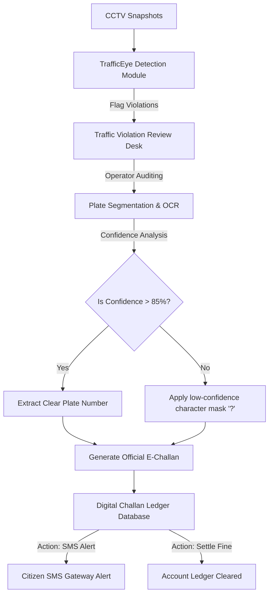

# TrafficEye 🚦📸
> **Automated Municipal Traffic Violation Enforcement System | Flipkart Smart City Hackathon Submission**

TrafficEye is an engineering prototype designed for automated municipal traffic law enforcement, tailored for the **Bengaluru Traffic Police (BTP)**. Integrating computer vision (simulating YOLOv8 and Tesseract.js OCR), the system processes roadside CCTV snapshots to automatically detect common infractions, verify vehicle registration plates, and manage the digital citation (E-Challan) lifecycle.

---

## 📌 Problem Statement
As urban traffic density scales in metropolitan hubs like Bengaluru, manual policing of traffic safety laws is no longer viable. Safety infractions—specifically **riding without a helmet, triple riding, wrong parking, and traffic signal jumping**—contribute to over 60% of urban traffic accidents and cause severe gridlocks in high-congestion zones (e.g., Silk Board Junction, Marathahalli). 

Automated enforcement systems are required to:
1. **Reduce manual monitoring overhead** by flagging candidate violations using edge computer vision.
2. **Increase compliance** by providing a rapid validation portal for human operators to review and confirm detections.
3. **Automate citation workflows** by generating official e-challans linked to vehicle registration databases and dispatching notices instantly.

---

## 💡 Proposed Solution
TrafficEye introduces a three-tiered enforcement portal that bridges automated CV inference with human verification:
* **Central Analytics Cockpit**: Evaluates system validation metrics, daily enforcement counters, and category distributions.
* **Traffic Violation Review System**: Offers an interactive canvas where operators can adjust confidence thresholds, run license plate OCR segmentation, and audit detected infractions.
* **E-Challan Registry Ledger**: Maintains an active ledger of all issued citations, supporting search queries, compliance metrics tracking, and mock fine settlement gateways.

---

## ⚙️ System Architecture

---

## 🌟 Key Features

### 1. Municipal Analytics Dashboard
* **Real-time Operational Metrics**: Monitors Violations Detected Today, Active Cases under review, Total Dispatched E-Challans, and Average Detection Confidence.
* **Incident Distribution Plots**: Visualizes trends using Chart.js, plotting violation category breakdowns and hourly infraction rates.
* **Recent Detections Feed**: Ledger showing live system detections awaiting human review.

### 2. Traffic Violation Review Center
* **CV Bounding Box Overlay**: Draws high-precision bounding boxes around vehicles, license plates, and signals.
* **Operator Confidence Control**: Features a threshold slider (50% - 95%) that dynamically filters out low-confidence detections from the canvas.
* **Imperfect OCR Simulation**: Models realistic municipal camera constraints (confidence limits of 75%-92%). Plate characters are masked with a `?` if OCR confidence falls below 85% (e.g. `KA-03-M?-4820`).
* **OCR Confidence Separator**: Explicitly displays OCR confidence levels separately from the plate string for audit logs.

### 3. E-Challan Management Ledger
* **Search & Query Capabilities**: Quickly filters citations by Challan ID or Vehicle Registration number.
* **Dispatched Notices Tracker**: Filters the registry ledger by Challan Status (Unpaid, Dispatched, Paid).
* **BTP Compliance Reports**: Automatically calculates Total Fines Levied, Fines Paid/Settled, Pending Amounts, and Settlement Rates in Indian Rupees (₹) under standard Motor Vehicles Act fee schedules:
  - **No Helmet Rider**: ₹500
  - **Triple Riding**: ₹1,000
  - **Wrong Parking Zone**: ₹500
  - **Signal Jumping / Red Light**: ₹1,000

---

## 🛠️ Technology Stack

* **Frontend Engine**: HTML5, Semantic DOM API.
* **Styling**: Vanilla CSS3 styled with a professional slate-gray government console design (Primary Blue: `#1E40AF`, Success Green: `#15803D`, Warning Amber: `#D97706`, Danger Red: `#B91C1C`).
* **Visualizations**: Chart.js API served via CDN.
* **OCR Library**: Tesseract.js API client for client-side license plate character extraction.

---

## 🚀 Local Execution

The prototype runs client-side with zero external setup required.

### Quick Start
1. Open the project folder.
2. Double-click [index.html](file:///c:/Users/YAGNESH/OneDrive/Desktop/portfolio/index.html) to run the system directly in any modern web browser.

---

## 🔮 Future Scope
1. **VAHAN Database Integration**: Connecting the OCR output directly to standard government vehicle registry APIs to pull vehicle model, chassis numbers, and owner contact details automatically.
2. **FASTag Auto-Billing Gateways**: Enabling direct debit of fine balances from the vehicle owner's linked toll wallets upon confirmation of the citation.
3. **SMS Alert Service**: Connecting cellular SMS API gateways (e.g., Twilio) to dispatch actual SMS alerts with payment links to registered mobile numbers.
